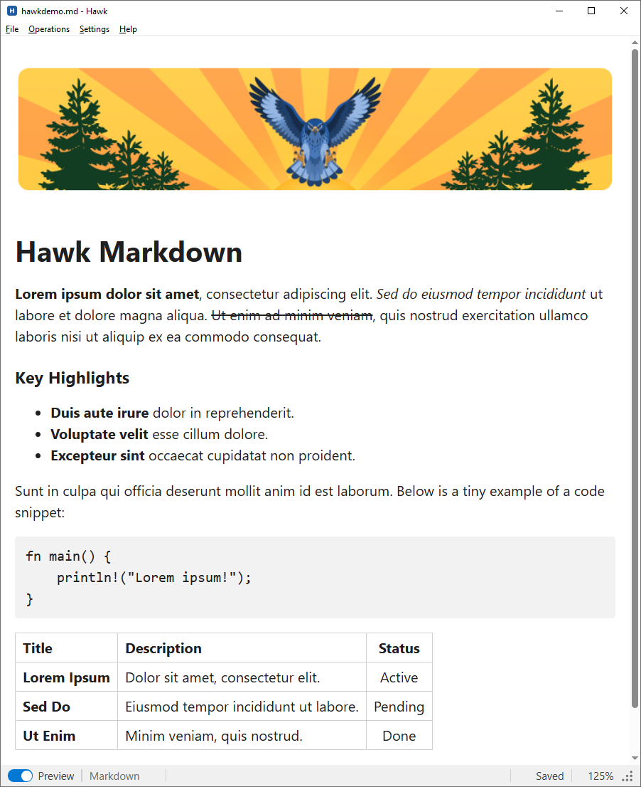
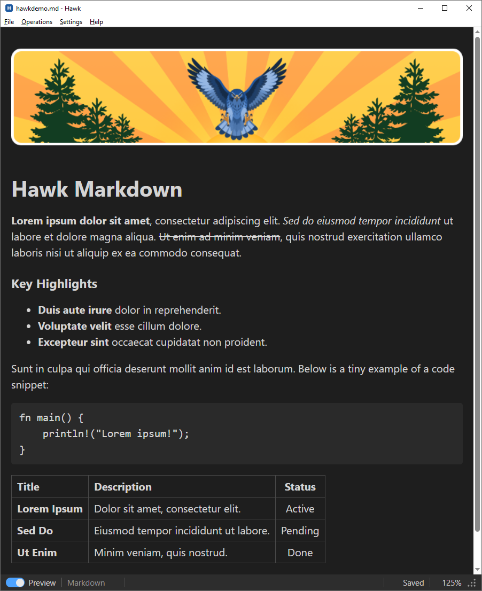

# Hawk

A small, fast, notepad-style text editor for Windows with live Markdown and
HTML preview. Built with Tauri 2 and Rust, with a plain HTML/CSS/JS front end
(no bundler, no Node dependency).

## Features

- Markdown and HTML preview
- Works 100% offline
- Tiny binary (under 5 MB)
- HTML/JSON reformatting
- Line ending conversion: Windows (CR LF) / Unix (LF)
- Line operations like sorting and removing duplicate/blank lines
- Interactive spellcheck
- Light and Dark display modes
- Zoom with Ctrl+Plus / Ctrl+Minus / Ctrl+0
- Drag files onto the window to open them
- Optional installer integration: Explorer context menu, PATH, default app
  for `.md` files

## Simple Design

|  |  |
| --- | --- |

## Markdown and HTML preview

The **Preview** switch in the status bar is enabled for `.md`, `.html` and
`.htm` files. It replaces the editor with a read-only rendering of the
current text, saved or not; switching it off returns to the editor. Preview
always starts off when a file is opened, unless Hawk was started with
`--preview`.

- **Markdown** is rendered with [marked](https://github.com/markedjs/marked),
  bundled in `ui/vendor/`, so no network access is needed.
- **HTML** is rendered in a sandboxed iframe (`sandbox="allow-scripts"`).
  A full document (one with an `<html>` element) is shown exactly as
  authored, scripts included; a fragment is wrapped in a page that matches
  the display theme. Scripts in the document run, but can't reach Hawk.
- **Relative resources** (images, stylesheets or scripts referenced by a
  relative path) aren't loaded from disk; only inline content and
  `http(s)://` URLs resolve.
- **Links:** hovering a link shows its target in the status bar. Clicking a
  web or `mailto:` link opens it in the default app. Clicking a link to a
  local file opens that file in a new Hawk window (in preview if it's
  previewable); the path is resolved against the document's folder, so the
  document must be saved. `#anchor` links scroll within the preview.
- If rendering fails, the status bar shows an error with a **more** link for
  the details, and the preview shows the raw text instead.

## Persistent settings

Settings (word wrap, spellcheck, tabs, display mode and zoom) are saved as
soon as they change and restored at the next launch. They're stored as JSON
in the per-user app data folder, not the registry:

```
%APPDATA%\io.github.hexnod.hawk\settings.json
```

If the file is missing, Hawk uses its defaults and recreates the file the
next time a setting changes.

## Cursor-vanish workaround (Windows)

After typing, the mouse cursor can disappear while it's outside the
document area, for example over the title bar, and stay hidden until it
moves back over the document.

**Why it happens:** the WebView2 runtime hosting Hawk's content has its own
"hide cursor while typing" behavior. It swaps in an invisible cursor and
only swaps it back on mouse movement inside its own client area. Movement
over the non-client area (the title bar, which Windows owns) never reaches
WebView2, so the invisible cursor stays. This started with WebView2 runtime
version 152.

**The fix:** Hawk subclasses its top-level window and calls
`ShowCursor(TRUE)` on every `WM_NCMOUSEMOVE` (see
`install_cursor_vanish_workaround` in `src-tauri/src/main.rs`).

The workaround can be removed once WebView2 fixes the underlying issue. A
similar issue is tracked at
[MicrosoftEdge/WebView2Feedback#5687](https://github.com/MicrosoftEdge/WebView2Feedback/issues/5687).

## Application log

Start Hawk with `--log` to write a log to `hawk.log`, next to `hawk.exe`.
Each line has the format `[UTC timestamp] [PID] message`. If the file is
over 1 MB when Hawk starts, it's deleted and started fresh.

## Project layout

```
hawk/
├── LICENSE                   # Apache License 2.0
├── NOTICE                    # Copyright and attributions
├── THIRD-PARTY-NOTICES.txt   # Licenses of bundled third-party software
├── docs/
│   └── images/               # README screenshots
├── ui/                       # Front end (the webview content)
│   ├── index.html
│   ├── styles.css
│   ├── main.js
│   └── vendor/
│       └── marked.umd.js     # Markdown parser (MIT)
└── src-tauri/                # Rust/Tauri backend
    ├── Cargo.toml
    ├── build.rs
    ├── tauri.conf.json
    ├── about.toml            # cargo-about config (third-party notices)
    ├── about.hbs             # cargo-about output template
    ├── capabilities/
    │   └── default.json
    ├── icons/
    ├── windows/
    │   └── hooks.nsh         # NSIS installer hooks (finish-page options)
    └── src/
        └── main.rs
```

Most of the app lives in `ui/main.js`, using Tauri's global JS API
(`window.__TAURI__`). The Rust side handles file I/O, the native menu,
settings, launching new instances and the Windows-specific workarounds.

## Prerequisites (on the Windows machine you build on)

1. **Rust** — install via <https://rustup.rs> (installs `cargo`/`rustc`
   with the MSVC toolchain, which is what you want on Windows).
2. **Microsoft C++ Build Tools** — install the "Desktop development with
   C++" workload from the Visual Studio Build Tools installer (needed by
   the MSVC linker).
3. **WebView2 Runtime** — already preinstalled on current Windows 10/11;
   if missing, Tauri's installer will offer to fetch it, or you can install
   it from Microsoft directly.
4. **Tauri CLI**, installed once as a cargo subcommand:

   ```powershell
   cargo install tauri-cli --locked --version "^2.0.0"
   ```

## Building

Get the source from <https://github.com/hexnod/hawk>:

```powershell
git clone https://github.com/hexnod/hawk.git
cd hawk
```

From the project root (the folder containing this README):

```powershell
cargo tauri build
```

This will:

- Compile the Rust backend in release mode.
- Bundle the app into an NSIS Windows installer under
  `src-tauri/target/release/bundle/nsis/`.
- Also leave a plain, standalone executable at
  `src-tauri/target/release/hawk.exe` that you can copy and run directly
  without installing anything.

### Quick iteration while developing

```powershell
cargo tauri dev
```

This compiles in debug mode and opens the app (there's no dev server/HMR
since the front end is static, but this is still faster to iterate with than
a full release build).

### Building without the Tauri CLI

If you'd rather not install `tauri-cli`, you can build the raw Rust binary
directly with `cargo build --release --manifest-path src-tauri/Cargo.toml`,
but you will not get the NSIS installer step or automatic embedding of
`tauri.conf.json`'s window settings via the bundler — using `cargo tauri
build` is recommended.

### Updating the third-party notices

`THIRD-PARTY-NOTICES.txt` lists the Rust crates compiled into `hawk.exe`
(for the Windows target) plus marked. After changing dependencies,
regenerate it from `src-tauri/`:

```powershell
cargo install cargo-about --locked --features cli
cargo about generate about.hbs -o ../THIRD-PARTY-NOTICES.txt
```

The installer copies `LICENSE`, `NOTICE` and `THIRD-PARTY-NOTICES.txt` next
to `hawk.exe`.

## Running

```
hawk [OPTIONS] [FILE]

  FILE            Text file to open. Without it, Hawk starts with an empty,
                  untitled document.
  --preview       Open FILE in preview mode, if its type supports preview
                  (.md, .html, .htm). Otherwise the status bar says preview
                  isn't available - no dialog.
  --log           Append diagnostic messages to hawk.log, next to hawk.exe.
  --version       Print the version and exit.
  -h, --help, /?  Print usage and exit.
  --              Treat everything after this as FILE, even if it starts
                  with "-".
```

For example:

```powershell
hawk.exe                          # blank Untitled document
hawk.exe C:\notes\todo.txt         # open a file
hawk.exe --preview C:\notes\a.md   # open a Markdown file straight into preview
```

Unknown options, or more than one FILE, print an error and exit with code
2. Release builds are Windows GUI programs, so `--help`/`--version` output
goes to the console Hawk was started from (because the shell doesn't wait
for GUI programs, the prompt may already be showing above it), to a file
or pipe if redirected (`hawk --version > v.txt`), or to a message box if
there's no console at all (e.g. a shortcut).

Dropping files from Explorer onto the window opens each one in a new Hawk
instance.

## Installer options

The last page of the installer ("Completing Hawk Setup") adds three
checkboxes below Tauri's own "Run Hawk" and desktop-shortcut ones. On a
fresh install they start unchecked; on a reinstall each starts checked if
that option is already in place, and unchecking it removes it.

- **Add "Edit with Hawk" to the Explorer context menu**: a right-click verb
  for every file type. On Windows 11 it appears under **Show more
  options**; the new compact menu only takes entries from packaged (MSIX)
  apps.
- **Add Hawk to the PATH environment variable**: appends the install
  folder to the PATH (user PATH for the default per-user install), so
  `hawk` works from a new console. If the existing PATH is too long for
  the installer to update without truncating it, nothing is changed and
  the installer says so.
- **Make Hawk the default app for .md files**: registers a `Hawk.md` file
  type, makes it the default for `.md`, and lists Hawk under **Settings →
  Default apps**. Windows doesn't let installers override a default the
  user picked themselves; in that case the installer offers to open
  Default apps so you can switch.

Uninstalling removes all three (restoring `.md`'s previous handler), except
during an update. The code is in `src-tauri/windows/hooks.nsh`, wired in
through `bundle.windows.nsis.installerHooks` in `tauri.conf.json`. The
options aren't applied in passive/silent installs, which skip the finish
page.

## License

Hawk is licensed under the [Apache License, Version 2.0](LICENSE).
Copyright and attributions are in [NOTICE](NOTICE); licenses of bundled
third-party software are in [THIRD-PARTY-NOTICES.txt](THIRD-PARTY-NOTICES.txt).

## Notes

- **Resize corner (Windows):** WebView2 covers the whole window, so the
  bottom-right corner wouldn't otherwise respond to resize drags. A small
  native window over the status bar's corner answers Windows' hit test as
  the resize corner (`install_resize_overlay` in `main.rs`).
- **Keyboard shortcuts:** the menus show Ctrl+N/O/S, but native menu
  accelerators don't fire reliably while WebView2 has focus, so the
  shortcuts are handled in `ui/main.js` (and forwarded from the preview).
- **Dialogs:** the save-changes and About dialogs are in-app overlays,
  because Tauri's dialog plugin has no Yes/No/Cancel message box. Open and
  Save As use the native Windows file pickers.
- **Tauri version:** the project depends on Tauri `^2`, so builds pick up
  the latest 2.x. If a release renames part of the menu or window API, the
  changes are confined to `src-tauri/src/main.rs`.
